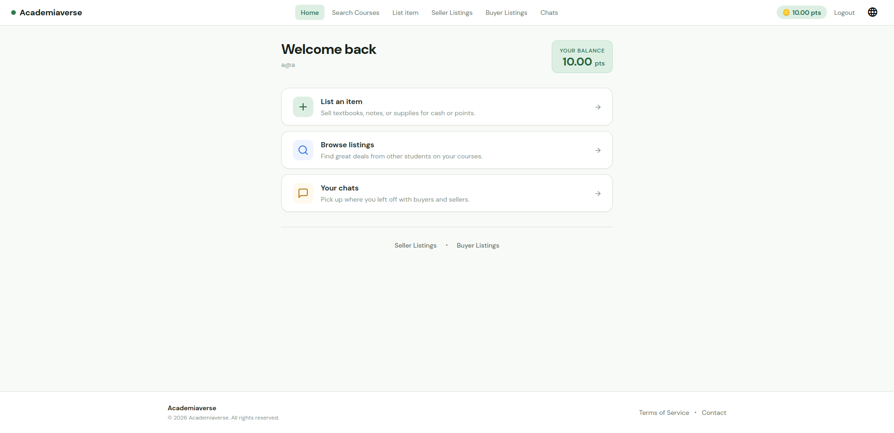
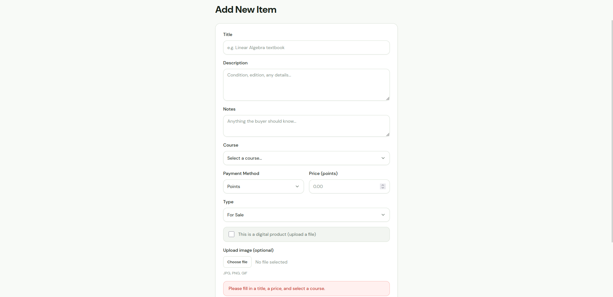
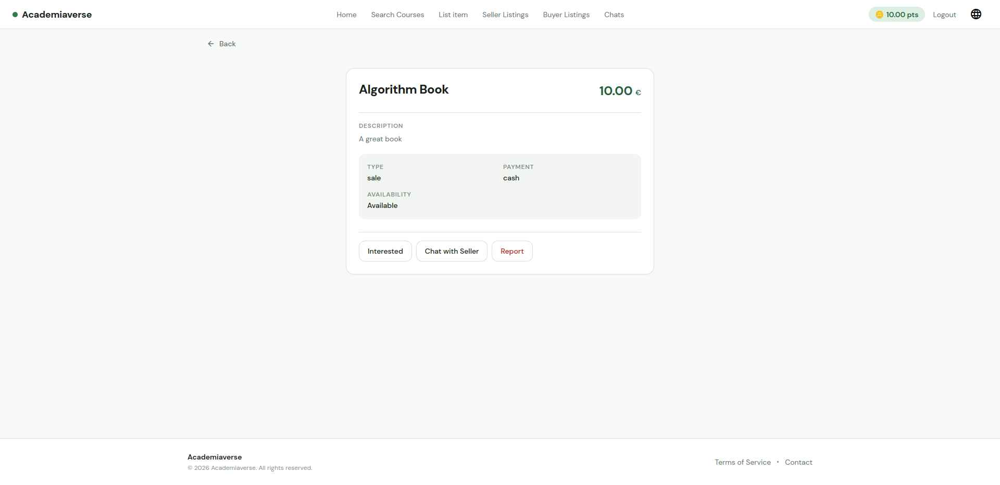
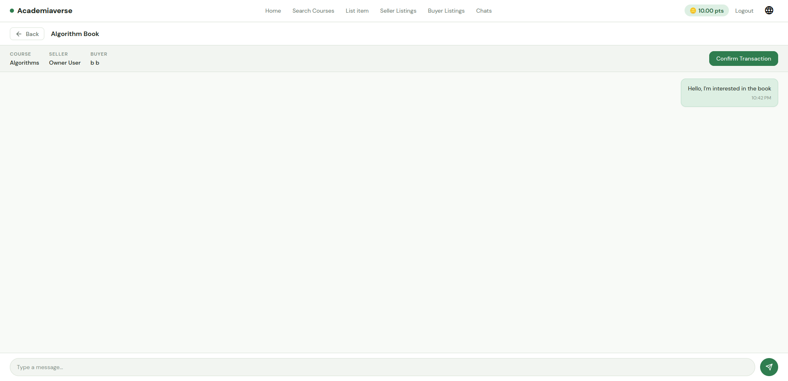

# Team_05 — AcademiaVerse

A web application with an Angular frontend, a Spring Boot backend, and a MySQL database.
The frontend is internationalized and ships in English and Arabic.

## Project

### The team

Our team of 6 was composed of :
- 1 Product Owner who choose the application that we had to develop
- 1 Scrum Master
- 1 Lead Developer
- 1 DevOps Developer
- 1 Test Developer
- 1 Regular Developer

My role was to implement user stories like the other developers. In addition, I was reponsible of the deployment of the project with Docker. I also set up a CI/CD pipeline on Gitlab which was used to compile the project, execute unit tests and end-to-end tests, run a static analysis...

### The application

This web application allow students to sell, buy and rent academic resources between them. Physical resources (like books) can be bought with cash, virtual resources (like PDF notes) can be bought with online points. Each resource is associated with a course in order to help students to find academic resources in their field of study. There is also a system of chat to help buyers and sellers to communicate. Intersted buyers can also add items to their lists of interests. The whole application is translated in English and in Arabic.

**Menu page**


**Adding a new item to sell**


**List of items currently on sale**


**Example of the chat**


## Tech stack

- **Frontend:** [Angular](https://angular.dev/) 21 (TypeScript), Angular Material, i18n (English / Arabic)
- **Backend:** [Spring Boot](https://spring.io/projects/spring-boot) 4 (Java 21), Spring Data JPA, Spring Security + JWT, Gradle
- **Database:** MySQL 8 (run via Docker)
- **Testing:** JUnit + JaCoCo (backend), Vitest (frontend unit), Cypress (end-to-end)
- **CI/CD:** GitLab CI (see [DEVOPS_README.md](DEVOPS_README.md))

## Requirements

- Java 21
- Gradle 7.5+ (a Gradle wrapper is included, so a local install is optional)
- Node.js (with npm) and the Angular CLI
- Docker + Docker Compose (for the database)

## Setup & running

Start the three parts in order. Once running:

- English: http://localhost:4200
- Arabic: http://localhost:4201

**1. Database (MySQL via Docker)**

```bash
docker compose up -d
```

> Use the `docker compose` (v2) plugin, not the legacy `docker-compose` v1 — v1 fails with
> `KeyError: 'ContainerConfig'` when recreating the container. If you hit that, run
> `docker compose down` (or `docker rm -f mysql-db`) first, then `docker compose up -d`.

To open a database shell (password `root`):

```bash
docker exec -it mysql-db mysql -u root -p
```

**2. Backend (Spring Boot)**

```bash
cd src/backend
./gradlew bootRun        # Linux / macOS
gradlew.bat bootRun      # Windows
```

**3. Frontend (Angular)**

```bash
cd src/frontend
npm install
npx ng serve                                   # English, http://localhost:4200
npx ng serve --configuration=ar --port 4201    # Arabic, http://localhost:4201
```

## Running tests

**Backend** (from `src/backend`):

```bash
./gradlew test
```

**Frontend unit tests** (from `src/frontend`):

```bash
npm test                 # or: ng test --watch=false
```

### Full local CI pipeline

To run the complete build → static analysis → test → deploy pipeline locally:

```bash
./ci-local.sh
```

## Code conventions

- Avoid abbreviations in identifiers — prefer full, descriptive names over short ones.
- Use clear, descriptive names for functions, classes, and entities.
- Avoid comments where the code is simple and self-explanatory.
